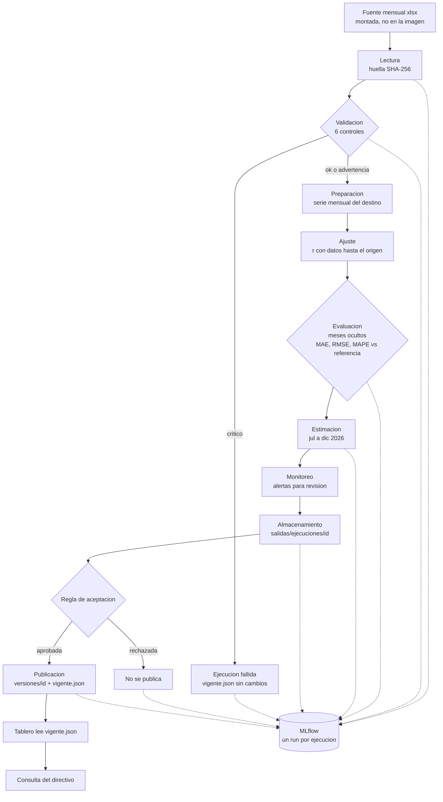

# Laboratorio 11: MLOps del observatorio (Lago de Atitlan, grupo 3)

Documentacion tecnica del flujo reproducible: alcance, diagrama, controles de calidad, registro en
MLflow, validacion temporal, regla de aceptacion, integracion con el tablero, monitoreo,
recuperacion y operacion con Docker. El informe en PDF esta en `report/lab11/Informe_Lab11.pdf`.

## 1. Alcance

| Elemento | Definicion |
|---|---|
| Variable | Visitantes internacionales mensuales atribuidos al Lago de Atitlan (Solola) |
| Unidad | visitantes por mes |
| Agregacion | mensual, destino completo |
| Fuente | `Base_Migracion_2009-2026jun.xlsx`, hoja `Datos` (base de migracion de uso academico, ene 2009 a jun 2026) |
| Columnas | `Año`, `Mes cod`, `Mes`, `Vía`, `Frontera`, `País`, `Agrupación Residencia`, `Tipo de Viajero`, `Viajero` |
| Indispensables | anio, mes, tipo, viajeros |
| Clave y granularidad | anio, mes, via, frontera, pais, agrupacion, tipo: una fila por combinacion y mes |
| Periodo de ajuste | 2023-01 a 2025-06 (desde 2023 la fuente cambia de metodologia; no se mezclan niveles) |
| Periodo de evaluacion | 2025-07 a 2026-06 (12 meses observados que se ocultan) |
| Periodo estimado | 2026-07 a 2026-12 |
| Archivo que lee el tablero | `salidas/vigente.json`, que apunta a `salidas/versiones/<id>/estimaciones.parquet` |

**Procedimiento** (`pipeline/procedimiento.py`, version 1.0.0): estacional con ajuste de nivel.

```
destino(t)   = sum_tipo factor_tipo * llegadas_tipo(t)
y_hat(o + h) = y(o + h - 12) * r(o)
r(o)         = sum(y[o-11 .. o]) / sum(y[o-23 .. o-12])        (ventana k = 12)
```

`o` es el ultimo mes observado. Cada mes estimado repite el mismo mes de doce meses antes, escalado por
el crecimiento de los ultimos 12 meses frente a los 12 previos. No tiene componentes aleatorios; la
semilla (2026) se fija igual por si se agregan.

**Parametros y supuestos**

- Factor de reparto: 0.20 de los turistas nacionales y 0.0 de los excursionistas (no pernoctan y
  casi todos cruzan por fronteras terrestres lejanas a Solola). Es un **supuesto**: la base de
  migracion no registra destinos. Queda marcado como `SUPUESTO` en `config/config.yaml` y el
  control f) emite una advertencia mientras no tenga fuente.
- La serie del destino hereda la tendencia y la estacionalidad nacionales; solo el nivel depende
  del factor.
- Un mes sin registros queda vacio (NaN), nunca en cero.
- Referencia sencilla: repetir el ultimo valor observado antes del periodo evaluado.

Todo esta en `config/config.yaml`: rutas, periodos, formula, factor, semilla, umbrales de
aceptacion, monitoreo, MLflow y tolerancia de reproducibilidad.

## 2. Diagrama del flujo



Puntos de control: los datos se validan en **Validacion**, el procedimiento se evalua en
**Evaluacion** y la publicacion se autoriza en **Regla de aceptacion**. Solo la rama aprobada
cambia `vigente.json`.

## 3. Pipeline

```bash
python -m pipeline                                 # usa config/config.yaml
python -m pipeline --fuente RUTA/BASE.xlsx         # o la variable OBS_FUENTE
```

Etapas: lectura, validacion, preparacion, ajuste, evaluacion, estimacion, almacenamiento y
publicacion. Cada ejecucion escribe en `salidas/ejecuciones/<id>/`: `registro.log`,
`manifiesto.json` (commit, huellas, dependencias, etapas, resultado), `calidad.json` y `.md`,
`perfil.json`, `monitoreo.json`, `datos_preparados.parquet`, `evaluacion.parquet`,
`estimaciones.parquet`, `observados.parquet`, `metricas.json`, `parametros.json` y la copia de
`config.yaml` usada. No se editan archivos intermedios a mano ni se depende de una sesion abierta.
Codigo de salida: 0 publicada, 2 rechazada, 1 fallida.

El tablero esta separado del procesamiento: solo lee archivos de `salidas/`. Cambiar un filtro no
ejecuta el pipeline (lo verifica `tests/test_app.py::test_estimaciones_filtro_no_reajusta`).

Dependencias fijas en `requirements-pipeline.txt` (pandas 3.1.0, numpy 2.5.4, pyarrow 25.0.1,
openpyxl 3.1.5, PyYAML 6.0.3, mlflow 3.17.2) y `requirements-docker.txt` (mas streamlit 1.66.1 y
plotly 7.1.0). Cada ejecucion registra las versiones instaladas.

## 4. Controles de calidad

Cada control termina en ok, advertencia o critico. Un critico detiene el pipeline antes de ajustar,
asi que nunca se reemplaza la version vigente. El reporte queda en `calidad.md` y `calidad.json`.

| Control | Que verifica | Advertencia | Detiene |
|---|---|---|---|
| a) Columnas y tipos | Columnas de la fuente; anio, mes, tipo y viajeros con tipo compatible | Falta una columna descriptiva | Falta una indispensable o tiene valores no convertibles |
| b) Fechas y cobertura | Fechas validas; cada mes de ajuste y evaluacion con registros de los tipos usados | Nombre de mes distinto a su codigo, o falta un mes fuera del periodo necesario | Mes fuera de 1-12, anio menor al minimo, fecha futura o mes necesario sin informacion |
| c) Unicidad | Clave anio-mes-via-frontera-pais-agrupacion-tipo | Repetidas solo en tipos no usados | Repetidas en tipos usados (doble conteo) |
| d) Faltantes | Distingue ausencias permitidas | Faltantes en columnas descriptivas o en tipos no usados | Falta anio, mes o tipo, o el conteo de un tipo usado |
| e) Valores y denominadores | Conteos finitos y no negativos; denominador de r mayor que cero | Mes evaluado con observado cero (sale del MAPE) | Conteo negativo o no finito en tipos usados, o denominador de r cero |
| f) Regla metodologica | La serie suma solo turistas y excursionistas de la fuente mensual, sin columnas diarias ni filas de total, y concilia con la suma directa | Factor de reparto sin fuente documentada | Tipos que no son visitantes, granularidad diaria, filas de total, factor fuera de [0, 1] o serie que no concilia |

Los periodos sin cobertura no se convierten en cero: quedan NaN y el control b) detiene la
ejecucion. Hay una prueba por control y por caso en `tests/test_pipeline.py`.

## 5. Registro en MLflow

Experimento `observatorio-lago-de-atitlan`. El run se crea al inicio: si MLflow no responde, el
pipeline se detiene antes de leer datos y no publica una version que no se pueda rastrear.

| Que | Donde en el run |
|---|---|
| Identificador y fecha | nombre del run = id de ejecucion; etiquetas `inicio`, `fin` |
| Version del codigo | etiqueta `git_commit` (en Docker viene de `GIT_COMMIT`, fijado al construir) y `cambios_sin_commit` |
| Fuente y huella | `fuente_archivo`, `fuente_sha256`, `fuente_filas` |
| Configuracion | `config_sha256` (sin rutas) y el artefacto `config.yaml` |
| Periodos y parametros | parametros `periodo_*`, `ventana_nivel`, `formula`, `factor_*`, umbrales |
| Metricas | `mae`, `rmse`, `mape`, `referencia_*`, `r_evaluacion`, `r_estimacion` (solo si la evaluacion se completo) |
| Controles y monitoreo | etiquetas `calidad.*`, `aceptacion.*`, `monitoreo.*`; metricas `calidad_*_filas`, `monitoreo_alertas` |
| Archivos | todos los archivos de la ejecucion como artefactos, incluidos `estimaciones.parquet`, `parametros.json` y `registro.log` |

Estado del run: FINISHED si se publico o se rechazo, FAILED si se detuvo.

Consulta: `python -m pipeline.consultar` lista las ejecuciones, identifica las fallidas con su
causa y compara las estimaciones de las dos ultimas ejecuciones completas con la misma huella de
fuente y configuracion. Deja `evidencia/mlflow_ejecuciones.csv` y `evidencia/mlflow_consulta.md`.

Resultado registrado (8 ejecuciones en el equipo de Fabian):

- 6 publicadas con MAE 4,458.34 y MAPE 11.139 % identicos. Las ejecuciones `113614-7a0ca0` y
  `113708-33f338` (mismo commit, misma fuente, misma configuracion) dan diferencia maxima 0 en
  las 6 estimaciones; la tolerancia configurada es 1e-6 visitantes. El procedimiento es
  determinista y no hay diferencias numericas que explicar.
- 2 fallidas, sin metricas porque se detuvieron en la validacion: `113642-74246e` (falta la
  columna `Viajero`, control a) y `113653-a51e91` (2 filas con clave repetida, control c).
- Las ejecuciones de recuperacion leen una copia en parquet: su huella de fuente cambia aunque el
  contenido es el mismo, y sus estimaciones coinciden con las de la fuente original.
- La primera ejecucion en Docker (`20261101T173335-b4655f`) quedo con hora UTC en el id porque la
  imagen aun no fijaba la zona horaria; desde el commit `698023e` los contenedores usan
  America/Guatemala.

## 6. Validacion temporal y regla de aceptacion

**Validacion.** Se ocultan los 12 meses de 2025-07 a 2026-06 y se estiman desde el origen 2025-06,
con r calculado solo con datos hasta ese mes (r = 1.116). Un horizonte de 1 a 12 meses respeta el
orden temporal: ningun dato posterior al origen entra al calculo
(`test_evaluacion_no_usa_informacion_futura` multiplica por 10 los datos futuros y verifica que la
estimacion no cambia).

| | MAE (visitantes) | RMSE | MAPE |
|---|---|---|---|
| Procedimiento | 4,458 | 5,102 | 11.14 % |
| Referencia: ultimo valor (37,385) | 6,138 | 8,159 | 13.30 % |

El procedimiento supera a la referencia: su MAE es 73 % del de la referencia. Sobreestimo 11 de
los 12 meses: r = 1.116 extrapola el crecimiento de 2024-2025, que en 2026 se desacelero. El MAPE
excluye los meses con observado cero y reporta cuantos excluyo; en este periodo no hubo ninguno.

**Limitaciones para reproducir enero y febrero de 2026.**

- No existe un conteo observado del destino para ningun mes. La serie "observada" es la nacional
  por un factor supuesto, asi que el error mide el procedimiento sobre la dinamica nacional, no
  contra visitantes reales del lago.
- La base si trae enero y febrero de 2026 a nivel nacional. Dentro de la definicion de este flujo
  son comparables y entran en la evaluacion (error de 1.6 % en enero y 24.2 % en febrero), pero no
  reproducen la situacion de un destino sin dato propio.
- En la situacion real el ultimo mes con dato seria diciembre de 2025 (horizonte 1 y 2). Aqui esos
  meses se estiman con horizonte 7 y 8 desde junio de 2025, un escenario mas exigente.
- La fuente cambia de metodologia en 2023: no hay suficientes periodos comparables para repetir la
  validacion con varios origenes sin mezclar niveles.

**Regla de aceptacion** (`aceptacion` en `config/config.yaml`, aplicada en `pipeline/run.py`). Una
version candidata se publica solo si cumple las cuatro condiciones:

1. Ningun control de calidad en estado critico.
2. Salidas completas: 6 meses estimados, todos finitos y no negativos.
3. MAPE de la evaluacion menor o igual a 15 %.
4. MAE menor o igual a 1.25 veces el MAE de la referencia en los mismos meses.

Justificacion: el MAPE y la razon de MAE no dependen de la escala, asi que la regla no cambia
aunque se corrija el factor de reparto, que hoy es un supuesto. Con el promedio observado de la
evaluacion (42,272 visitantes por mes), 15 % equivale a unos 6,300 visitantes por mes; es un error
menor que la variacion interanual tipica de la serie desde 2023 (mediana de 12 %, percentil 90 de
29 %), asi que el procedimiento aporta informacion. El margen de 1.25 sobre la referencia admite un
procedimiento algo peor en una sola ventana de 12 meses, donde la diferencia entre MAE es ruidosa,
pero rechaza uno claramente peor. La regla no se modifico despues de ver los resultados de este
laboratorio.

## 7. Tablero

Pagina **Estimaciones del destino** (`paginas/estimaciones.py`, datos en `src/estimaciones.py`):

- Lee `salidas/vigente.json` y los archivos de esa version; la cache depende del id, asi que al
  publicar o restaurar se lee la nueva version.
- Observado en linea negra continua; estimado en violeta discontinuo con puntos huecos, el tramo
  estimado sombreado y la etiqueta "Estimado", igual que el resto del tablero.
- Muestra fecha de actualizacion, el error de validacion con su explicacion, los meses evaluados y
  la comparacion con la referencia, y una advertencia sobre el factor de reparto y el caracter no
  oficial de las cifras.
- Sin version aprobada muestra que las estimaciones no estan disponibles. Con una version
  restaurada lo indica.
- Los detalles tecnicos (parametros, ejecuciones) quedan en MLflow y en este documento.

Cada `estimaciones.parquet` incluye destino, periodo, valor, unidad, tipo de valor, id de
ejecucion, fecha de generacion y version del procedimiento.

## 8. Monitoreo y recuperacion

**Registro por ejecucion**: `salidas/ejecuciones/<id>/registro.log` (inicio, cada etapa
completada, resultado de cada control y verificacion de monitoreo, advertencias, errores y
resultado de la publicacion) y `manifiesto.json` (horas de inicio y fin, etapas, estado, error).
Ejemplos en `evidencia/registros/`.

**Verificaciones de monitoreo** (`pipeline/monitoreo.py`, umbrales en `monitoreo` de la
configuracion). Una alerta queda en el registro, el manifiesto y MLflow y pide revision; por si sola
no rechaza la version ni demuestra perdida de precision. El error predictivo solo se actualiza en
la evaluacion, cuando hay observaciones comparables.

| Verificacion | Que revisa | Umbral y justificacion |
|---|---|---|
| Actualizacion | La fuente llega al ultimo periodo esperado (2026-06) y las estimaciones empiezan el mes siguiente | Cobertura configurada; tambien avisa si la fuente ya trae meses nuevos |
| Calidad | Filas, faltantes, claves repetidas y meses con datos frente al perfil de la version vigente | Filas: 10 %. Un mes nuevo agrega cerca de 0.5 % de filas, asi que mas de 10 % indica un cambio de estructura. Faltantes y duplicados: cualquier aumento. Cobertura: cualquier perdida |
| Resultados | Estimaciones negativas o no finitas; variacion interanual; cambio frente a la version vigente | Interanual 30 %: desde 2024 el 95 % de las variaciones observadas del destino es menor que 28 %. Cambio entre versiones 10 %: con un mes nuevo r cambia pocos puntos |

**Prueba controlada** (`python -m pipeline.prueba_controlada --problema columna|duplicado|denominador`):
copia la fuente, introduce el problema en la copia, ejecuta, verifica que la version vigente y sus
archivos no cambiaron, corrige la copia y ejecuta de nuevo. Se corrio con `columna` y `duplicado`
(evidencia en `evidencia/prueba_controlada_*.md`): ambas ejecuciones con problema fallaron en el
control esperado, la version aprobada quedo intacta y la ejecucion corregida se publico. En el caso
del duplicado el monitoreo de calidad tambien alerto (claves repetidas de 0 a 2). Las pruebas
automaticas cubren los tres problemas con datos sinteticos.

**Restaurar una version aprobada.** `salidas/versiones/` conserva todas las versiones aprobadas
(ninguna se borra). Para volver a una anterior:

```bash
python -m pipeline.restaurar --listar          # * marca la vigente
python -m pipeline.restaurar --anterior        # la que estaba antes de la vigente
python -m pipeline.restaurar --id 20261101T113614-7a0ca0
```

Solo cambia `vigente.json` de forma atomica; el tablero muestra la version restaurada al recargar
la pagina y avisa que es una version anterior. Se demostro restaurando `113614-7a0ca0` (captura en
el informe) y volviendo despues a `113708-33f338`.

## 9. Operacion con Docker

**Requisitos previos**: Docker Desktop (o Docker Engine con Compose v2), git y unos 2 GB libres
para la imagen.

**Datos institucionales**: por defecto en `data/raw/Base_Migracion_2009-2026jun.xlsx`. Si estan en
otra carpeta, definir `DATOS_DIR` con la carpeta que contiene `raw/`. Los datos se montan en los
contenedores; `.dockerignore` excluye `data/` de la imagen.

**Configuracion inicial**: revisar `config/config.yaml` (periodos, factor, umbrales). Se monta en
solo lectura, asi que un cambio no requiere reconstruir la imagen.

```bash
export GIT_COMMIT=$(git rev-parse HEAD)     # PowerShell: $env:GIT_COMMIT = git rev-parse HEAD
docker compose build
docker compose up -d                        # MLflow y tablero
docker compose run --rm pipeline            # una ejecucion del pipeline
docker compose run --rm pipeline python -m pipeline.consultar
docker compose run --rm pipeline python -m pipeline.prueba_controlada --problema columna
docker compose run --rm pipeline python -m pipeline.restaurar --anterior
docker compose down                         # detener
```

**Acceso**: tablero en http://127.0.0.1:8501 (pagina "Estimaciones del destino"); MLflow en
http://127.0.0.1:5000 (elegir "Model training" y el experimento `observatorio-lago-de-atitlan`).
Los puertos solo se publican en 127.0.0.1.

**Registros y resultados**: `salidas/ejecuciones/<id>/` (todas las ejecuciones, no versionadas),
`salidas/versiones/<id>/` y `salidas/vigente.json` (versiones aprobadas, versionadas en git),
`mlflow/mlflow.db` y `mlflow/artefactos/` (MLflow), `evidencia/` (consultas y pruebas).

**Persistencia**: `salidas/` y `mlflow/` son carpetas montadas del repositorio, no volumenes
internos. `docker compose down` y un nuevo `up`, o una imagen reconstruida, las conservan.

**Sin Docker**: `python -m venv .venv`, instalar `requirements-pipeline.txt`, levantar MLflow con
`docker compose up -d mlflow` (o `mlflow server --backend-store-uri sqlite:///mlflow/mlflow.db
--artifacts-destination mlflow/artefactos`) y correr `python -m pipeline`.

**Pruebas**: `python -m pytest tests` (56 pruebas). Las del pipeline usan datos sinteticos y un
MLflow temporal; tambien corren dentro del contenedor:
`docker compose run --rm pipeline python -m pytest tests/test_pipeline.py`.

**Copia limpia**: se clono el repositorio desde GitHub en una carpeta nueva, sin `mlflow/` ni
`salidas/ejecuciones/`, y se ejecuto `build`, `up -d` y `run --rm pipeline`. La ejecucion se
publico con las mismas metricas (MAE 4,458.34, MAPE 11.14 %), las 28 pruebas del pipeline pasaron
dentro del contenedor, el tablero y MLflow respondieron, y despues de `down` y `up` el run seguia
en MLflow y `vigente.json` seguia apuntando a la version publicada.
